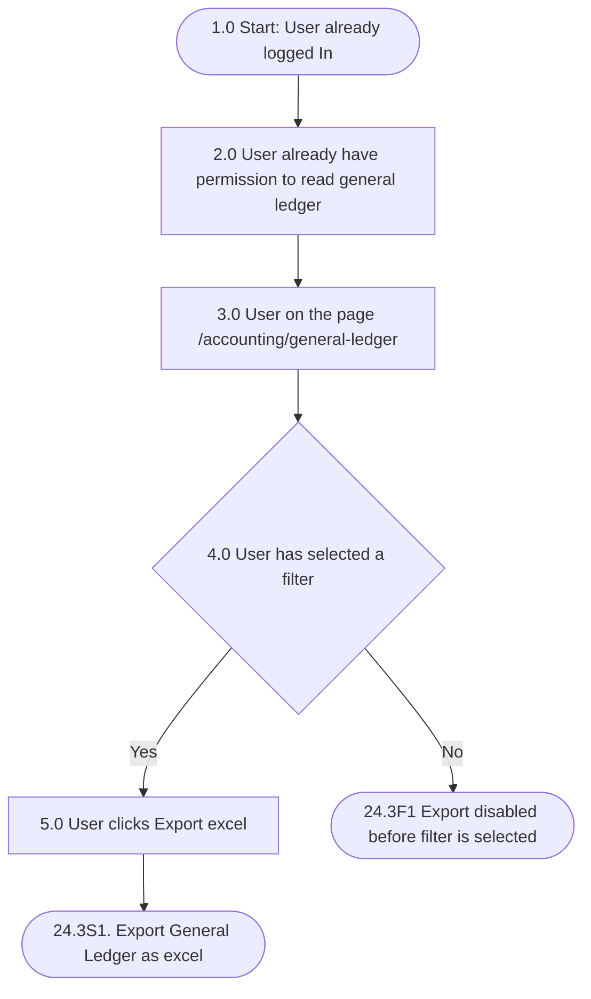
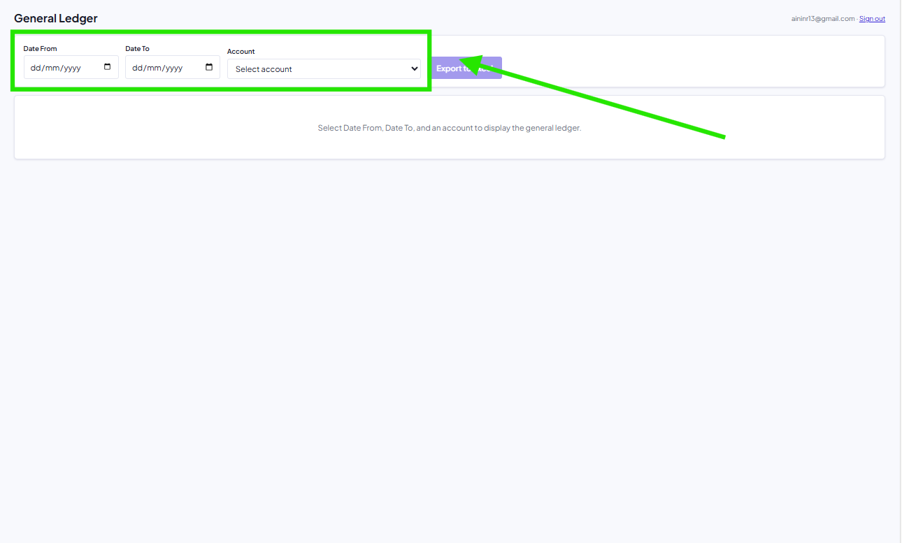
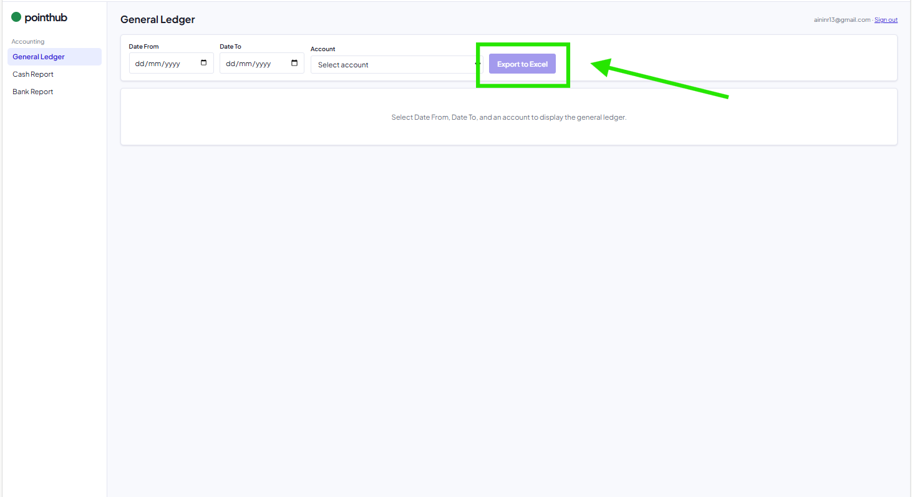
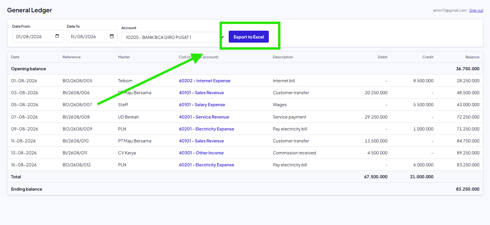
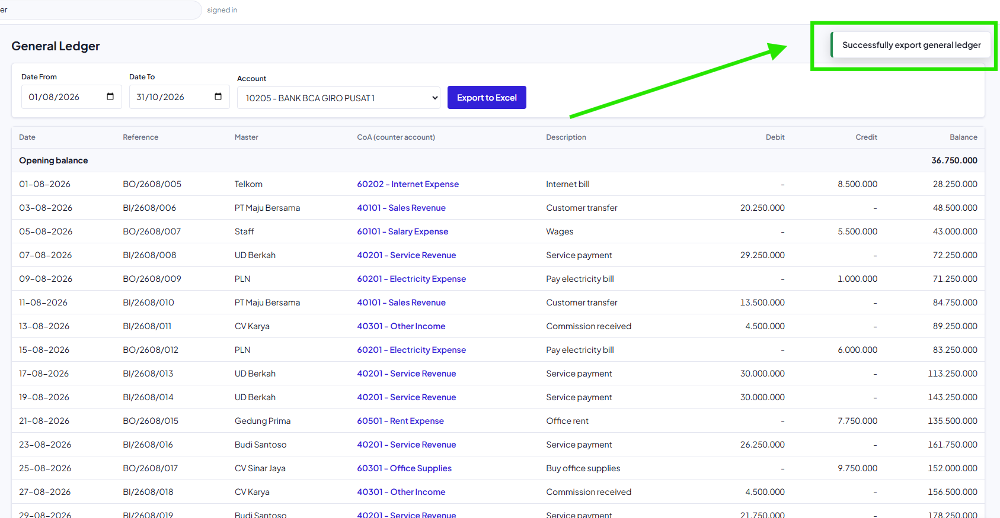

## Mindmap alur

| Process No. | Type | Process / Validation | Yes → Next | No → Next | End? |
|---|---|---|---|---|---|
| 1.0 | Start | User already logged In | 2.0 | | No |
| 2.0 | Process | User already have permission to read general ledger | 3.0 | | No |
| 3.0 | Process | User on the page /accounting/general-ledger | 4.0 | | No |
| 4.0 | Validation | user has selected a filter. | 5.0 | 24.3F1 Export disabled before filter is selected | Yes |
| 5.0 | Process | User clicks Export excel | 24.3S1. Export General Ledger as excel | | Yes |

## Acceptance criteria

### 24.3F1 Export disabled before filter is selected

| Step | Gherkin step | Mockup |
|---|---|---|
| 1.0 | Given User logged In | |
| 2.0 | And User have permission to read the general ledger report | |
| 3.0 | And User on the general ledger page | |
| 4.0 | And date range and account filter are not selected yet |  |
| 5.0 | When user view the "Export to Excel" button | |
| 6.0 | Then the "Export to Excel" button is disabled |  |
| 7.0 | And the system does not generate any Excel file | |

### 24.3S1. Export General Ledger as excel

| Step | Gherkin step | Mockup |
|---|---|---|
| 1.0 | Given User logged in | |
| 2.0 | And User has permission to read the general ledger report | |
| 3.0 | And User have access into account 10205-BANK BCA GIRO PUSAT 1 | |
| 4.0 | And User is on the general ledger page | |
| 5.0 | And date range and account filter are already applied |  |
| 6.0 | When the user clicks "Export to Excel" | |
| 7.0 | Then the system generates an Excel file of the filtered general ledger | |
| 8.0 | And the system show notifications "Successfully export general ledger" |  |
| 9.0 | And the system downloads the file to the user's device as format excel | [Contoh hasil export (Google Sheets)](https://docs.google.com/spreadsheets/d/1Td7t0MKHDdi2doihoESl3XjzegLXVbM72D7ucsAFQxI/edit?usp=sharing) |

## Referensi

- Nama dan isi file: [DB-5 Export & System Message](/general-ledger/database)
