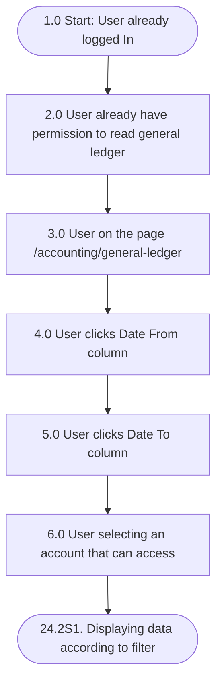

## Mindmap alur

| Process No. | Type | Process / Validation | Yes → Next | No → Next | End? |
|---|---|---|---|---|---|
| 1.0 | Start | User already logged In | 2.0 | | No |
| 2.0 | Process | User already have permission to read general ledger | 3.0 | | No |
| 3.0 | Process | User on the page /accounting/general-ledger | 4.0 | | No |
| 4.0 | Process | User clicks Date From column | 5.0 | | No |
| 5.0 | Process | User clicks Date To column | 6.0 | | No |
| 6.0 | Process | User selecting an account that can access | 24.2S1. Displaying data according to filter | | Yes |

## Acceptance criteria

<Note>
  Kolom **Mockup** menunjuk ke file screenshot (`ac-XX`) yang dikirim terpisah dan perlu diunggah ke halaman ini.
</Note>

### 24.2S1. Displaying data according to filter

| Step | Gherkin step | Mockup |
|---|---|---|
| 1.0 | Given User logged In | |
| 2.0 | And User has permission to read the general ledger report | |
| 3.0 | And User have access into account 10205-BANK BCA GIRO PUSAT 1 | |
| 4.0 | And User on the general ledger page | |
| 5.0 | When User selects 01-08-2026 on the column date from | ac-08 |
| 6.0 | And User selects 15-08-2026 on the column date to | ac-09 |
| 7.0 | And User selects 10205-BANK BCA GIRO PUSAT 1 on the column account | ac-10 |
| 8.0 | Then the system displays the general ledger data for the selected date range and account | ac-11 |

## Referensi

- Struktur filter: [DB-1 General Ledger Filter](/general-ledger/database)
- Sample filter: [SD-1](/general-ledger/database)
