Modul **General Ledger** memiliki tiga fitur. Kode skenario memakai awalan `F` untuk skenario gagal dan `S` untuk skenario sukses.

## Product Vision

Product vision disusun dengan kerangka SMART.

### Specific

Mampu digunakan untuk pencatatan seperti fungsi-fungsi di GNU, menggunakan lebih dari 1 admin dalam 1 platform, dengan menjaga kerahasiaan dan keamanan data akun utama.

### Measurable

1. Ketika user bisa melihat akun asal dan akun tujuan dengan mudah di 1 tampilan di samping transaksi, pada menu Cash & Bank list.
2. Ketika user bisa melihat akun asal dan akun tujuan dengan mudah di 1 tampilan di samping transaksi, pada menu General Ledger.
3. Ketika user bisa dengan mudah mengetahui dimana field untuk input bank / cash tujuan maupun bank / cash asal (tidak terbalik-balik).
4. Ketika user bisa "create" transaksi yang hanya boleh diakses oleh akun "Lioni", namun tetap tidak bisa melihat transaksi pada akun "Lioni" (user tersebut masih bisa akses transaksi Lioni yang dia create sendiri).
5. Memerlukan fitur yang seperti fungsi di GNU, namun punya hak akses, approval, dan reject.
6. Tampilan COA urut.
7. Bisa filter berdasarkan kategori income / expense pada tiap bank account.
8. Seluruh fitur mempunyai fungsi edit, termasuk bank/cash in.
9. Pembayaran tidak perlu melalui payment order, langsung cash/bank out dengan fitur approval.

### Achievable

Sesuai permintaan di atas.

### Relevant

Agar tidak perlu dobel kerja bagi admin maupun owner.

### Time

Mengikuti SOP.

## MOM

### ADR001: Tampilan Utama General Ledger

|  |  |
| --- | --- |
| **Tanggal** | 2026-10-15 |
| **Nomor** | ADR001 |
| **Person** | Aini, Bu Stefani |

#### Problem

User kesulitan membaca dan memahami transaksi secara jelas ketika melakukan filter berdasarkan CoA karena informasi lawan akun tidak ditampilkan.

General Ledger saat ini hanya menampilkan kolom Date, Reference, Master, Description, Debit, Credit, dan Balance, sehingga user kesulitan mengidentifikasi CoA yang menjadi lawan akun dalam suatu transaksi.

#### Option

**Mempertahankan tampilan General Ledger saat ini.**

- (+) Tampilan tetap sederhana dan tidak memerlukan perubahan.
- (-) User kesulitan mengidentifikasi lawan akun ketika melakukan filter berdasarkan CoA.

**Menampilkan informasi CoA dalam satu baris transaksi.**

- (+) Mempermudah user mengidentifikasi CoA dan lawan akun dalam transaksi.
- (+) Mempermudah user membaca dan memahami detail transaksi.
- (-) Membutuhkan penyesuaian tampilan General Ledger.

#### Decision

Menampilkan informasi CoA dalam satu baris transaksi pada tampilan utama General Ledger, dengan tetap mempertahankan kolom Date, Reference, Master, Description, Debit, Credit, dan Balance.

#### Reasoning

Mempermudah user membaca dan memahami transaksi secara jelas, terutama ketika melakukan filter berdasarkan CoA, dengan menyediakan informasi lawan akun yang relevan.

### ADR002: Hak Akses Data General Ledger Berdasarkan Role Permission CoA

|  |  |
| --- | --- |
| **Tanggal** | 2026-10-15 |
| **Nomor** | ADR002 |
| **Person** | Aini, Bu Stefani |

#### Problem

Bu Lioni ingin memastikan bahwa Ce Feifei hanya dapat melihat data transaksi pada CoA yang telah diberikan akses kepadanya.

Data transaksi yang dapat diakses oleh Bu Lioni dan Ce Feifei dapat berbeda, termasuk nominal transaksi yang ditampilkan, sesuai dengan hak akses masing-masing user.

Diperlukan pembatasan akses untuk menjaga kerahasiaan data transaksi Bu Lioni agar tidak dapat dilihat oleh user yang tidak memiliki hak akses.

#### Option

**Menampilkan seluruh data General Ledger kepada semua user.**

- (+) Implementasi lebih sederhana.
- (-) Data transaksi dapat diakses oleh user yang tidak memiliki hak akses.
- (-) Berisiko mengungkap informasi keuangan yang bersifat rahasia.

**Menampilkan data General Ledger berdasarkan hak akses CoA setiap user.**

- (+) Menjaga kerahasiaan data transaksi.
- (+) Memastikan setiap user hanya dapat melihat transaksi sesuai dengan hak aksesnya.
- (-) Membutuhkan penyesuaian mekanisme penyaringan data berdasarkan role permission CoA.

#### Decision

Menampilkan data General Ledger berdasarkan hak akses (role permission) CoA masing-masing user.

User hanya dapat melihat transaksi yang termasuk dalam CoA yang memiliki izin akses untuk user tersebut.

#### Reasoning

Menjaga kerahasiaan data transaksi Bu Lioni dengan membatasi informasi yang dapat diakses oleh setiap user sesuai dengan hak aksesnya.

Memastikan data dan nominal transaksi yang ditampilkan pada General Ledger sesuai dengan otorisasi masing-masing user.

## Sitemap

Sitemap aplikasi terdiri dari tiga kelompok menu: **Finance**, **Master**, dan **Report**. General Ledger berada di kelompok Report sebagai fitur nomor **24**.

```mermaid
flowchart TB
  app["Personal Finance"]

  app --> finance["Finance"]
  app --> master["Master"]
  app --> report["Report"]

  finance --> cashIn["18 Personal Finance Cash In"]
  cashIn --> ci1["18.1 Create Cash In"]
  cashIn --> ci2["18.2 Edit Cash In"]
  cashIn --> ci3["18.3 Delete Cash In"]
  cashIn --> ci4["18.4 List Cash In"]
  cashIn --> ci5["18.5 Detail Cash In"]

  finance --> cashOut["19 Personal Finance Cash Out"]
  cashOut --> co1["19.1 Create Cash Out"]
  cashOut --> co2["19.2 Edit Cash Out"]
  cashOut --> co3["19.3 Delete Cash Out"]
  cashOut --> co4["19.4 List Cash Out"]
  cashOut --> co5["19.5 Detail Cash Out"]
  cashOut --> co6["19.6 Approve Cash Out"]
  cashOut --> co7["19.7 Reject Cash Out"]

  finance --> bankIn["20 Personal Finance Bank In"]
  bankIn --> bi1["20.1 Create Bank In"]
  bankIn --> bi2["20.2 Edit Bank In"]
  bankIn --> bi3["20.3 Delete Bank In"]
  bankIn --> bi4["20.4 List Bank In"]
  bankIn --> bi5["20.5 Detail Bank In"]

  finance --> bankOut["21 Personal Finance Bank Out"]
  bankOut --> bo1["21.1 Create Bank Out"]
  bankOut --> bo2["21.2 Edit Bank Out"]
  bankOut --> bo3["21.3 Delete Bank Out"]
  bankOut --> bo4["21.4 List Bank Out"]
  bankOut --> bo5["21.5 Detail Bank Out"]

  master --> coa["22 Chart of Account"]
  coa --> ca1["22.1 Create Chart of Account"]
  coa --> ca2["22.2 Edit Chart of Account"]
  coa --> ca3["22.3 Delete Chart of Account"]
  coa --> ca4["22.4 List Chart of Account"]
  coa --> ca5["22.5 Detail Chart of Account"]
  coa --> ca6["22.6 Approve Chart of Account"]
  coa --> ca7["22.7 Reject Chart of Account"]

  master --> coaGroup["23 Chart of Account Group"]
  coaGroup --> cg1["23.1 Create Chart of Account Group"]
  coaGroup --> cg2["23.2 Edit Chart of Account Group"]
  coaGroup --> cg3["23.3 Delete Chart of Account Group"]
  coaGroup --> cg4["23.4 List Chart of Account Group"]
  coaGroup --> cg5["23.5 Detail Chart of Account Group"]
  coaGroup --> cg6["23.6 Approve Chart of Account Group"]
  coaGroup --> cg7["23.7 Reject Chart of Account Group"]

  report --> ledger["24 Personal Finance General Ledger"]
  ledger --> gl1["24.1 Read General Ledger"]
  ledger --> gl2["24.2 Filter General Ledger"]
  ledger --> gl3["24.3 Export General Ledger"]

  report --> cashReport["25 Personal Finance Cash Report"]
  cashReport --> cr1["25.1 Read Cash Report"]
  cashReport --> cr2["25.2 Print Cash Report"]
  cashReport --> cr3["25.3 Export Cash Report (Excel)"]
  cashReport --> cr4["25.4 Export Cash Report (PDF)"]
  cashReport --> cr5["25.5 Filter Cash Report"]
  cashReport --> cr6["25.6 Checklist Cash Report"]

  report --> bankReport["26 Personal Finance Bank Report"]
  bankReport --> br1["26.1 Read Bank Report"]
  bankReport --> br2["26.2 Print Bank Report"]
  bankReport --> br3["26.3 Export Bank Report (Excel)"]
  bankReport --> br4["26.4 Export Bank Report (PDF)"]
  bankReport --> br5["26.5 Filter Bank Report"]
  bankReport --> br6["26.6 Checklist Bank Report"]

  report --> allocation["27 Personal Finance Allocation Report"]
  allocation --> ar1["27.1 Export Allocation Report"]
  allocation --> ar2["27.2 Filter Allocation Report"]
  allocation --> ar3["27.3 Read Allocation Report"]
```

### Fitur dalam cakupan dokumen ini

| Kode | Fitur |
| --- | --- |
| 24.1 | [Read General Ledger](/general-ledger/read-general-ledger) |
| 24.2 | [Filter General Ledger](/general-ledger/filter-general-ledger) |
| 24.3 | [Export General Ledger](/general-ledger/export-general-ledger) |

## List scenario

| Module | Feature | Scenario |
|--------|---------|----------|
| General Ledger | [24.1 Read General Ledger](/general-ledger/read-general-ledger) | 24.1F1 User redirect to login page |
| | | 24.1F2 User redirect to forbidden page |
| | | 24.1F3 User sees no account to select |
| | | 24.1S1. Displaying General Ledger Data |
| | [24.2 Filter General Ledger](/general-ledger/filter-general-ledger) | 24.2S1. Displaying data according to filter |
| | [24.3 Export General Ledger](/general-ledger/export-general-ledger) | 24.3F1 Export disabled before filter is selected |
| | | 24.3S1. Export General Ledger as excel |

## Halaman terkait

<Columns cols={2}>
  <Card title="Acceptance criteria" icon="list-checks" href="/general-ledger/read-general-ledger">
    Gherkin step per skenario ada di halaman tiap fitur.
  </Card>
  <Card title="Database" icon="database" href="/general-ledger/database">
    Kolom, aturan, dan sample data.
  </Card>
</Columns>
