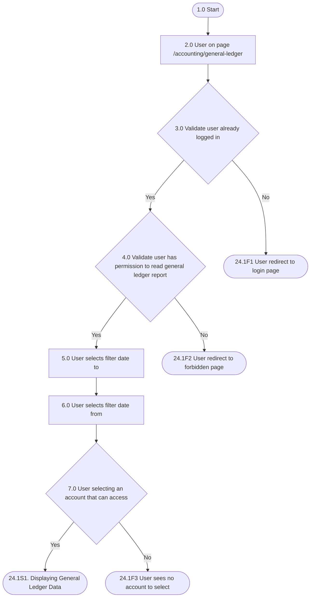
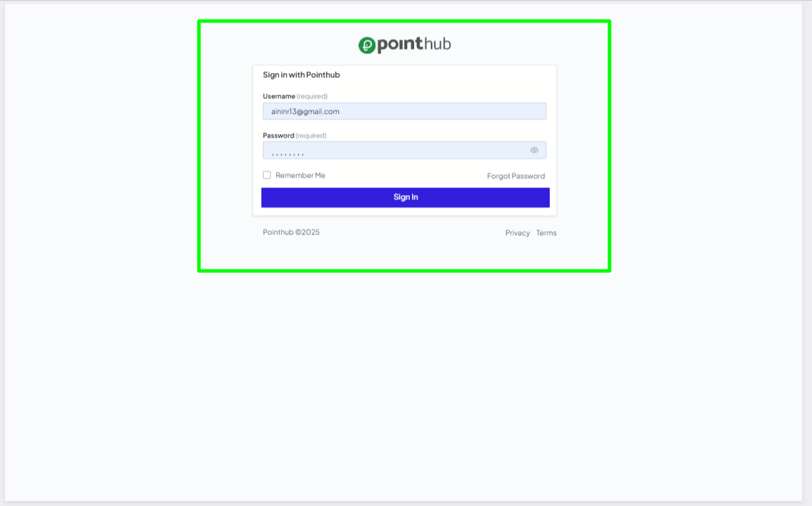
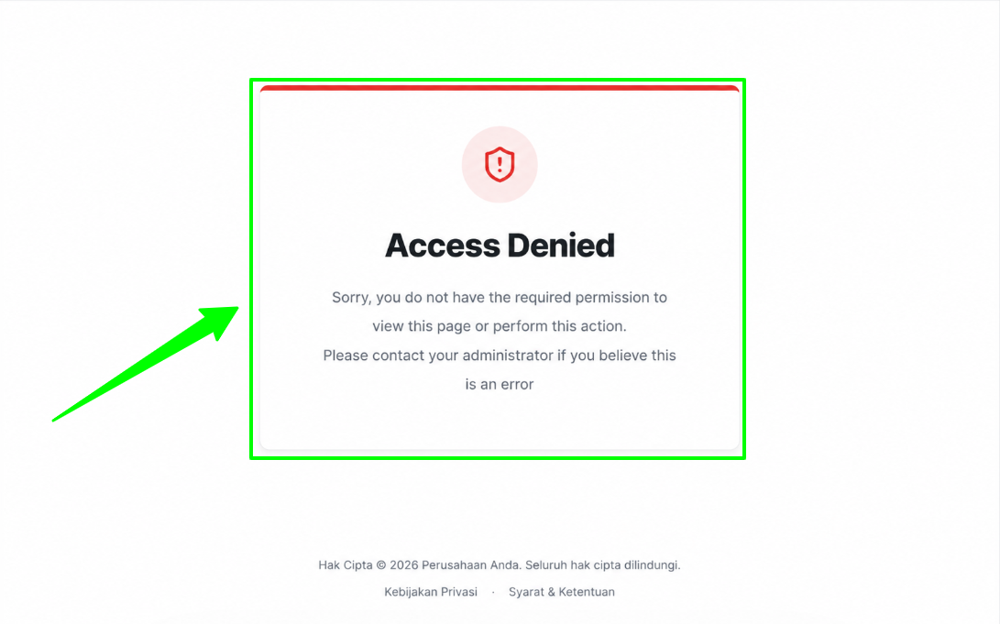
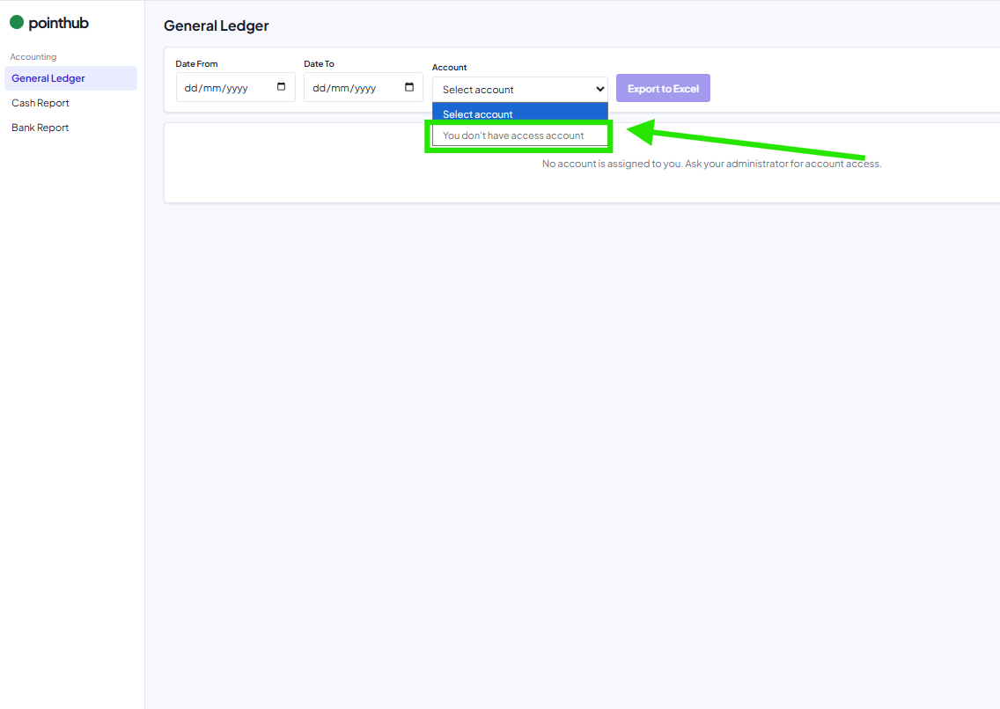
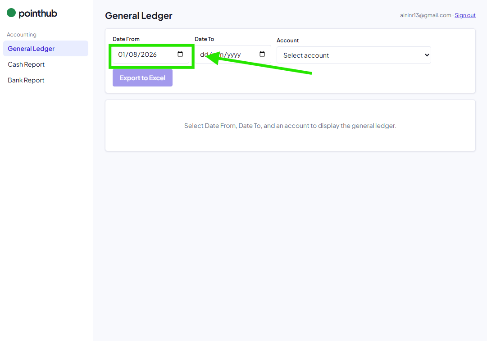
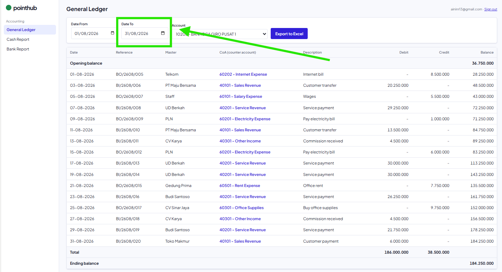
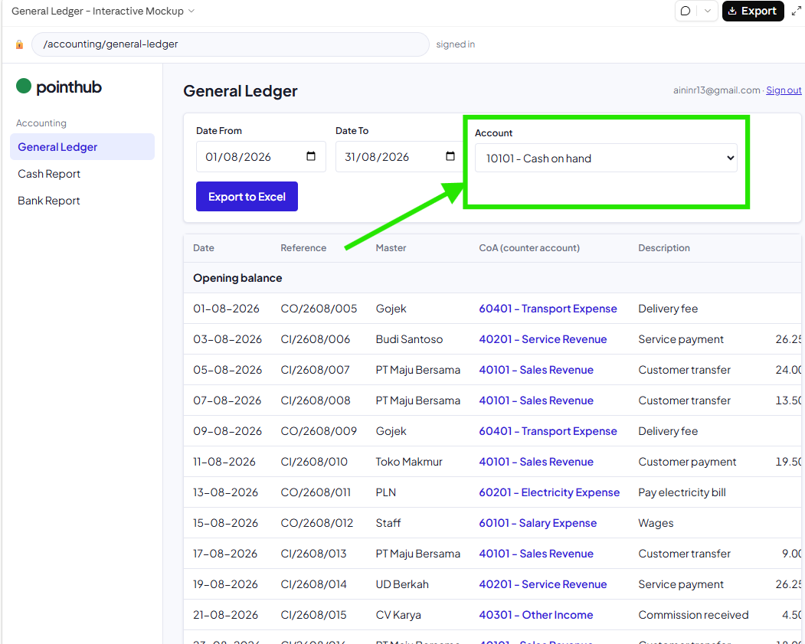
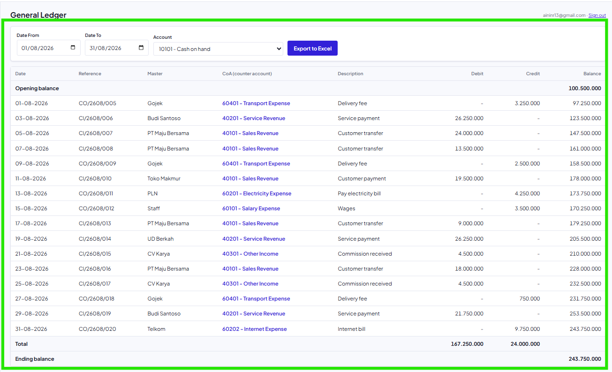

## Mindmap alur

| Process No. | Type | Process / Validation | Yes → Next | No → Next | End? |
|---|---|---|---|---|---|
| 1.0 | Start | Start | 2.0 | | No |
| 2.0 | Process | User on page /accounting/general-ledger | 3.0 | | No |
| 3.0 | Validation | Validate user already logged in | 4.0 | 24.1F1 User redirect to login page | Yes |
| 4.0 | Validation | Validate user has permission to read general ledger report | 5.0 | 24.1F2 User redirect to forbidden page | Yes |
| 5.0 | Process | User selects filter date to | 6.0 | | No |
| 6.0 | Process | User selects filter date from | 7.0 | | No |
| 7.0 | Validation | User selecting an account that can access | 24.1S1. Displaying General Ledger Data | 24.1F3 User sees no account to select | Yes |

## Acceptance criteria

### 24.1F1 User redirect to login page

| Step | Gherkin step | Mockup |
|---|---|---|
| 1.0 | Given user visit on the page /accounting/general-ledger | |
| 2.0 | When user not logged in | |
| 3.0 | Then User redirect to login page |  |

### 24.1F2 User redirect to forbidden page

| Step | Gherkin step | Mockup |
|---|---|---|
| 1.0 | Given User already logged In | |
| 2.0 | And User dont have permission to read general ledger | |
| 3.0 | When User type /accounting/general-ledger into browser | |
| 4.0 | Then User redirect to forbidden page |  |

### 24.1F3 User sees no account to select

| Step | Gherkin step | Mockup |
|---|---|---|
| 1.0 | Given User already logged In | |
| 2.0 | And User have permission to read general ledger report | |
| 3.0 | And User do not have access into any account | |
| 4.0 | When user type /accounting/general-ledger into browser | |
| 5.0 | Then the system not shows the account |  |

### 24.1S1. Displaying General Ledger Data

| Step | Gherkin step | Mockup |
|---|---|---|
| 1.0 | Given User already logged In | |
| 2.0 | And User have permission to read general ledger report | |
| 3.0 | And User have access into account "10101.Cash on hand" | |
| 4.0 | When User type /accounting/general-ledger into browser | |
| 5.0 | And User selects 01-08-2026 on column date from |  |
| 6.0 | And User selects 31-08-2026 on column date to |  |
| 7.0 | And User selects account "10101.Cash on hand" |  |
| 8.0 | Then the system displays the general ledger data for the selected date range and account |  |

## Referensi

- Keputusan tampilan: [ADR001](/mom)
- Hak akses CoA: [ADR002](/mom)
- Struktur data: [Database](/general-ledger/database)
