Sitemap aplikasi terdiri dari tiga kelompok menu: **Finance**, **Master**, dan **Report**. General Ledger berada di kelompok Report sebagai fitur nomor **24**.

```mermaid
flowchart TB
  app["Personal Finance"]

  app --> finance["Finance"]
  app --> master["Master"]
  app --> report["Report"]

  finance --> cashIn["18 Personal Finance Cash In"]
  cashIn --> ci1["18.1 Create Cash In"]
  cashIn --> ci2["18.2 Edit Cash In"]
  cashIn --> ci3["18.3 Delete Cash In"]
  cashIn --> ci4["18.4 List Cash In"]
  cashIn --> ci5["18.5 Detail Cash In"]

  finance --> cashOut["19 Personal Finance Cash Out"]
  cashOut --> co1["19.1 Create Cash Out"]
  cashOut --> co2["19.2 Edit Cash Out"]
  cashOut --> co3["19.3 Delete Cash Out"]
  cashOut --> co4["19.4 List Cash Out"]
  cashOut --> co5["19.5 Detail Cash Out"]
  cashOut --> co6["19.6 Approve Cash Out"]
  cashOut --> co7["19.7 Reject Cash Out"]

  finance --> bankIn["20 Personal Finance Bank In"]
  bankIn --> bi1["20.1 Create Bank In"]
  bankIn --> bi2["20.2 Edit Bank In"]
  bankIn --> bi3["20.3 Delete Bank In"]
  bankIn --> bi4["20.4 List Bank In"]
  bankIn --> bi5["20.5 Detail Bank In"]

  finance --> bankOut["21 Personal Finance Bank Out"]
  bankOut --> bo1["21.1 Create Bank Out"]
  bankOut --> bo2["21.2 Edit Bank Out"]
  bankOut --> bo3["21.3 Delete Bank Out"]
  bankOut --> bo4["21.4 List Bank Out"]
  bankOut --> bo5["21.5 Detail Bank Out"]

  master --> coa["22 Chart of Account"]
  coa --> ca1["22.1 Create Chart of Account"]
  coa --> ca2["22.2 Edit Chart of Account"]
  coa --> ca3["22.3 Delete Chart of Account"]
  coa --> ca4["22.4 List Chart of Account"]
  coa --> ca5["22.5 Detail Chart of Account"]
  coa --> ca6["22.6 Approve Chart of Account"]
  coa --> ca7["22.7 Reject Chart of Account"]

  master --> coaGroup["23 Chart of Account Group"]
  coaGroup --> cg1["23.1 Create Chart of Account Group"]
  coaGroup --> cg2["23.2 Edit Chart of Account Group"]
  coaGroup --> cg3["23.3 Delete Chart of Account Group"]
  coaGroup --> cg4["23.4 List Chart of Account Group"]
  coaGroup --> cg5["23.5 Detail Chart of Account Group"]
  coaGroup --> cg6["23.6 Approve Chart of Account Group"]
  coaGroup --> cg7["23.7 Reject Chart of Account Group"]

  report --> ledger["24 Personal Finance General Ledger"]
  ledger --> gl1["24.1 Read General Ledger"]
  ledger --> gl2["24.2 Filter General Ledger"]
  ledger --> gl3["24.3 Export General Ledger"]

  report --> cashReport["25 Personal Finance Cash Report"]
  cashReport --> cr1["25.1 Read Cash Report"]
  cashReport --> cr2["25.2 Print Cash Report"]
  cashReport --> cr3["25.3 Export Cash Report (Excel)"]
  cashReport --> cr4["25.4 Export Cash Report (PDF)"]
  cashReport --> cr5["25.5 Filter Cash Report"]
  cashReport --> cr6["25.6 Checklist Cash Report"]

  report --> bankReport["26 Personal Finance Bank Report"]
  bankReport --> br1["26.1 Read Bank Report"]
  bankReport --> br2["26.2 Print Bank Report"]
  bankReport --> br3["26.3 Export Bank Report (Excel)"]
  bankReport --> br4["26.4 Export Bank Report (PDF)"]
  bankReport --> br5["26.5 Filter Bank Report"]
  bankReport --> br6["26.6 Checklist Bank Report"]

  report --> allocation["27 Personal Finance Allocation Report"]
  allocation --> ar1["27.1 Export Allocation Report"]
  allocation --> ar2["27.2 Filter Allocation Report"]
  allocation --> ar3["27.3 Read Allocation Report"]
```

## Fitur dalam cakupan dokumen ini

| Kode | Fitur |
|------|-------|
| 24.1 | [Read General Ledger](/general-ledger/read-general-ledger) |
| 24.2 | [Filter General Ledger](/general-ledger/filter-general-ledger) |
| 24.3 | [Export General Ledger](/general-ledger/export-general-ledger) |
