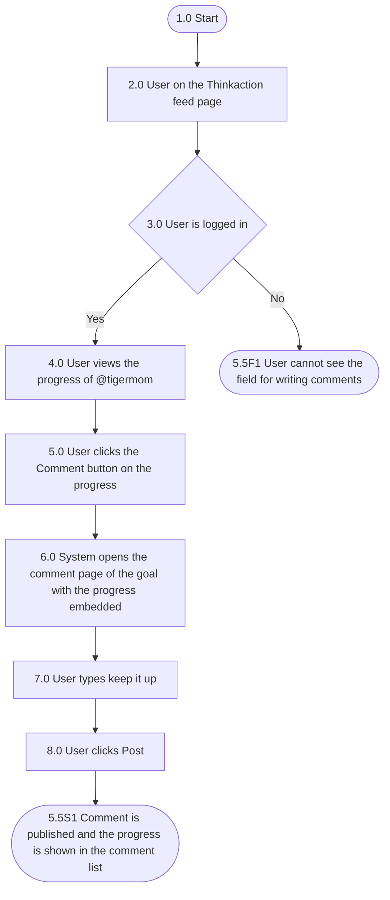

## Mindmap alur

| Process No. | Type | Process / Validation | Yes → Next | No → Next | End? |
| --- | --- | --- | --- | --- | --- |
| 1.0 | Start | Start | 2.0 |  | No |
| 2.0 | Process | User on the Thinkaction feed page | 3.0 |  | No |
| 3.0 | Validation | User is logged in | 4.0 | 5.5F1 User cannot see the field for writing comments | Yes |
| 4.0 | Process | User views the progress of @tigermom | 5.0 |  | No |
| 5.0 | Process | User clicks the "Comment" button at the bottom corner of the progress | 6.0 |  | No |
| 6.0 | Process | System opens the comment page of the goal with the progress embedded above the comment field | 7.0 |  | No |
| 7.0 | Process | User types "keep it up" in the comment field | 8.0 |  | No |
| 8.0 | Process | User clicks "Post" | 5.5S1 The comment is published and the progress is shown in the comment list |  | Yes |

## Acceptance criteria

### 5.5F1 User cannot see the field for writing comments

| Step | Gherkin step | Mockup |
| --- | --- | --- |
| 1.0 | Given user is not logged in to the Thinkaction app |  |
| 2.0 | When user opens the Thinkaction feed page |  |
| 3.0 | Then the feed page is displayed without the field for writing comments |  |

### 5.5S1 User comments on a progress and the progress is embedded in the comment list

| Step | Gherkin step | Mockup |
| --- | --- | --- |
| 1.0 | Given user @nraini is logged in to the Thinkaction app |  |
| 2.0 | And user @nraini is on the feed page |  |
| 3.0 | When user views the progress posted by @tigermom |  |
| 4.0 | And user clicks the "Comment" button at the bottom corner of the progress |  |
| 5.0 | Then the system opens the comment page of the goal of @tigermom |  |
| 6.0 | And the system shows the commented progress as an embed above the comment field |  |
| 7.0 | When user types "keep it up" in the comment field |  |
| 8.0 | And user clicks "POST" |  |
| 9.0 | Then the system publishes the comment |  |
| 10.0 | And the system shows the progress card labeled "PROGRESS" in the comment on the comment list page |  |

## Referensi

- Tombol "Back to progress" mengembalikan user ke progress.
- Foto progress bisa dilepas dengan tombol silang sebelum Post, sehingga komentar tampil sebagai komentar biasa.
- Jika progress sudah dihapus, kartu menampilkan "Progress no longer available".
