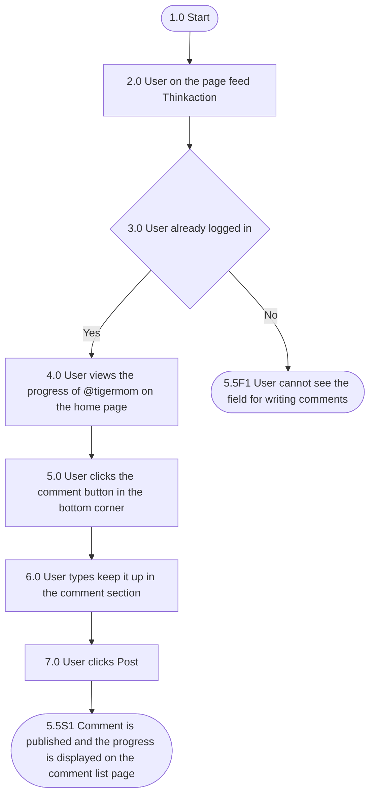

## Mindmap alur

| Process No. | Type | Process / Validation | Yes → Next | No → Next | End? |
| --- | --- | --- | --- | --- | --- |
| 1.0 | Start | Start | 2.0 |  | No |
| 2.0 | Process | User on the page feed Thinkaction | 3.0 |  | No |
| 3.0 | Validation | Validate user already logged in | 4.0 | 5.5F1 User cannot see the field for writing comments | Yes |
| 4.0 | Process | User views the @tigermom progress on the home page | 5.0 |  | No |
| 5.0 | Process | User clicks the comment button in the bottom corner | 6.0 |  | No |
| 6.0 | Process | User types "keep it up" in the comments section | 7.0 |  | No |
| 7.0 | Process | User clicks "post" | 5.5S1 Comment will be published, and the progress associated with it will be displayed on the comment list page |  | Yes |

## Acceptance criteria

### 5.5F1 User cannot see the field for writing comments

| Step | Gherkin step | Mockup |
| --- | --- | --- |
| 1.0 | Given the user is not logged in to ThinkAction App |  |
| 2.0 | When the user opens the ThinkAction Feed page |  |
| 3.0 | Then the system displays the Feed page without the field for writing comments |  |

### 5.5S1 Comment will be published, and the progress associated with it will be displayed on the comment list page

| Step | Gherkin step | Mockup |
| --- | --- | --- |
| 1.0 | Given the user is logged in to ThinkAction App and is on the Feed page |  |
| 2.0 | When the user views the progress update posted by @tigermom on the Home page |  |
| 3.0 | And the user clicks the comment button at the bottom corner of the progress update |  |
| 4.0 | And the user enters "keep it up" in the comment field |  |
| 5.0 | And the user clicks the Post button to publish the comment |  |
| 6.0 | Then the system publishes the comment and displays the associated progress update on the comment list page |  |

## Referensi

- Alur ini mengikuti ADR001: klik komentar membuka halaman komentar goal dengan progress yang dikomentari tampil sebagai embed.
- Struktur data komentar: [Database](/thinkaction/database).
