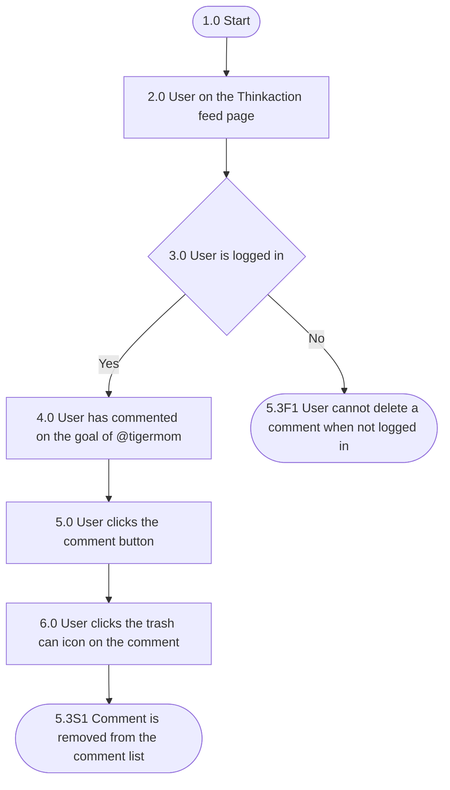

## Mindmap alur

| Process No. | Type | Process / Validation | Yes → Next | No → Next | End? |
| --- | --- | --- | --- | --- | --- |
| 1.0 | Start | Start | 2.0 |  | No |
| 2.0 | Process | User on the Thinkaction feed page | 3.0 |  | No |
| 3.0 | Validation | User is logged in | 4.0 | 5.3F1 User cannot delete a comment when not logged in | Yes |
| 4.0 | Process | User has commented on the goal of @tigermom | 5.0 |  | No |
| 5.0 | Process | User clicks the comment button | 6.0 |  | No |
| 6.0 | Process | User clicks the "trash can" icon on the comment | 5.3S1 Comment is removed from the comment list |  | Yes |

## Acceptance criteria

### 5.3F1 User cannot delete a comment when not logged in

| Step | Gherkin step | Mockup |
| --- | --- | --- |
| 1.0 | Given user is not logged in to the Thinkaction app |  |
| 2.0 | When user opens the Thinkaction feed page |  |
| 3.0 | And user opens the comment section of a goal |  |
| 4.0 | Then the comment list is displayed without the trash can icon |  |

### 5.3S1 User deletes own comment and the comment is removed from the comment list

| Step | Gherkin step | Mockup |
| --- | --- | --- |
| 1.0 | Given user @nraini is logged in to the Thinkaction app |  |
| 2.0 | And user @nraini has commented on the goal of @tigermom |  |
| 3.0 | When user clicks the comment button on the goal of @tigermom |  |
| 4.0 | Then the comment list is displayed with the trash can icon on the comment of @nraini |  |
| 5.0 | When user clicks the trash can icon on the comment of @nraini |  |
| 6.0 | Then the system shows "Comment deleted" with an "Undo" button for 5 seconds |  |
| 7.0 | And the system removes the comment from the comment list after 5 seconds |  |

## Referensi

- Penulis komentar bisa menghapus komentarnya sendiri. Pemilik goal bisa menghapus semua komentar di goalnya.
- Tombol "Undo" membatalkan penghapusan selama 5 detik pertama.
