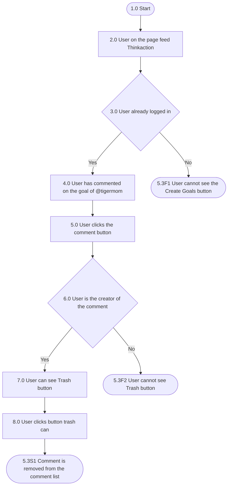
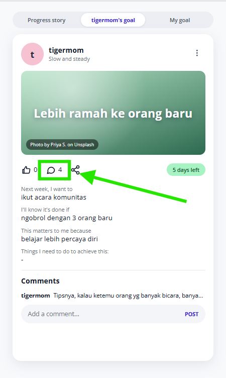
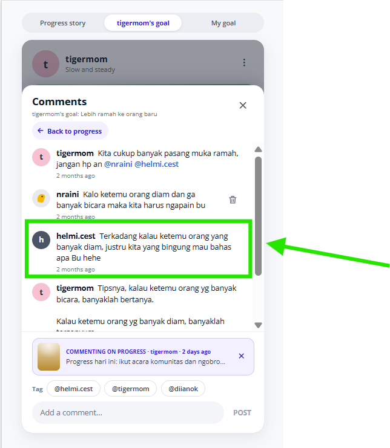
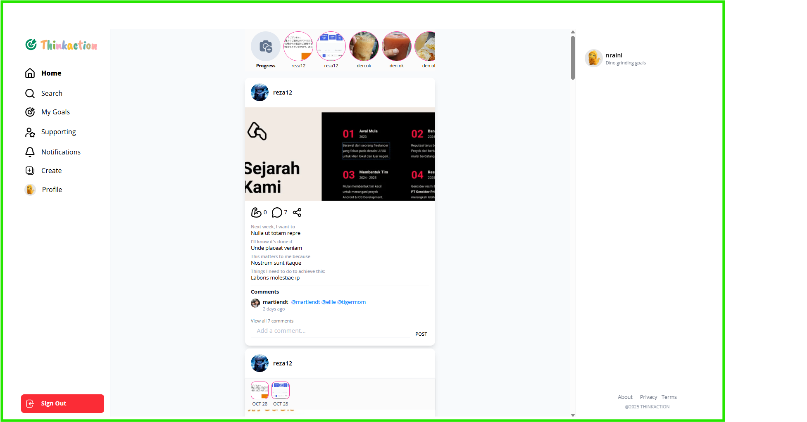
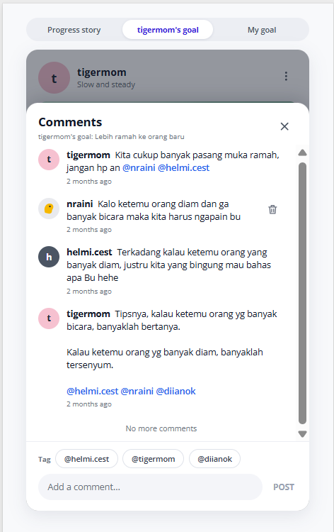
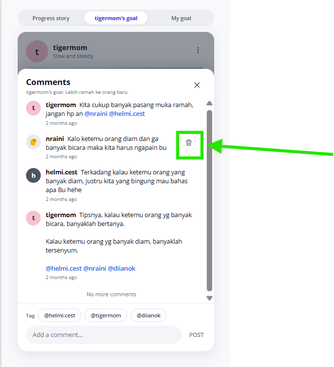
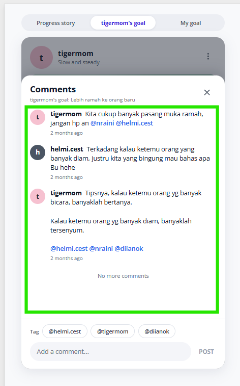

## Mindmap alur

| Process No. | Type | Process / Validation | Yes → Next | No → Next | End? |
| --- | --- | --- | --- | --- | --- |
| 1.0 | Start | Start | 2.0 |  | No |
| 2.0 | Process | User on the page feed Thinkaction | 3.0 |  | No |
| 3.0 | Validation | Validate user already logged in | 4.0 | 5.3F1 User cannot see the "Create Goals" button | Yes |
| 4.0 | Process | User has commented on the goal of @tigermom | 5.0 |  | No |
| 5.0 | Process | User clicks the comment button | 6.0 |  | No |
| 6.0 | Validation | Validate whether the user is the creator of the comment | 7.0 | 5.3F2 The user can't see "Trash button" | Yes |
| 7.0 | Process | User can see "Trash button" | 8.0 |  | No |
| 8.0 | Process | User clicks button "trash can" | 5.3S1 The comment is removed from the comment list |  | Yes |

## Acceptance criteria

### 5.3F1 User cannot see the "Create Goals" button

| Step | Gherkin step | Mockup |
| --- | --- | --- |
| 1.0 | Given the user is not logged in to ThinkAction App |  |
| 2.0 | When the user opens the ThinkAction Feed page |  |
| 3.0 | Then the system displays the Feed page without the "Create Goals" button |  |

### 5.3F2 The user can't see "Trash button"

| Step | Gherkin step | Mockup |
| --- | --- | --- |
| 1.0 | Given user @nraini is logged in to the Thinkaction app |  |
| 2.0 | And user @helmi.cest has commented on the goal of @tigermom |  |
| 3.0 | When user @nraini clicks the comment button on the goal of @tigermom |  |
| 4.0 | Then the comment list is displayed |  |
| 5.0 | And the comment of @helmi.cest is displayed without the trash button |  |
| 6.0 | And the system does not allow user @nraini to delete the comment of @helmi.cest |  |

### 5.3S1 The comment is removed from the comment list

| Step | Gherkin step | Mockup |
| --- | --- | --- |
| 1.0 | Given the user @nraini is logged in to ThinkAction App |  |
| 2.0 | When the user opens the comment section of the goal of @tigermom |  |
| 3.0 | And the user clicks the trash can icon on their comment |  |
| 4.0 | Then the system removes the selected comment from the comment list |  |

## Referensi

- Hanya pembuat komentar yang melihat tombol sampah dan bisa menghapus komentarnya.
- Struktur data komentar: [Database](/thinkaction/database).
