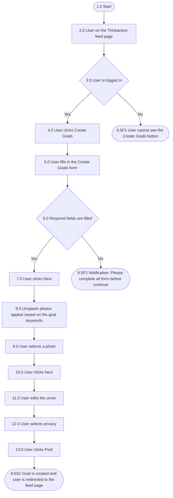

## Mindmap alur

| Process No. | Type | Process / Validation | Yes → Next | No → Next | End? |
| --- | --- | --- | --- | --- | --- |
| 1.0 | Start | Start | 2.0 |  | No |
| 2.0 | Process | User on the Thinkaction feed page | 3.0 |  | No |
| 3.0 | Validation | User is logged in | 4.0 | 6.5F1 User cannot see the "Create Goals" button | Yes |
| 4.0 | Process | User clicks the "Create Goals" button | 5.0 |  | No |
| 5.0 | Process | User enters data into the "Create Goals" form | 6.0 |  | No |
| 6.0 | Validation | User has filled in the required data | 7.0 | 6.5F2 User sees notification "Please complete all form before continue" | Yes |
| 7.0 | Process | User clicks "Next"; keywords from the "Next week, I want to" field appear immediately as search keywords on Unsplash | 8.0 |  | No |
| 8.0 | Process | User views the Unsplash photo references | 9.0 |  | No |
| 9.0 | Process | User selects a photo from Unsplash | 10.0 |  | No |
| 10.0 | Process | User clicks "Next" | 11.0 |  | No |
| 11.0 | Process | User edits the cover of the photo | 12.0 |  | No |
| 12.0 | Process | User selects the "privacy" visibility of the goal | 13.0 |  | No |
| 13.0 | Process | User clicks "Post" | 6.5S1 User successfully creates a goal and is redirected to the feed page |  | Yes |

## Acceptance criteria

### 6.5F1 User cannot see the "Create Goals" button

| Step | Gherkin step | Mockup |
| --- | --- | --- |
| 1.0 | Given user is not logged in to the Thinkaction app |  |
| 2.0 | When user opens the Thinkaction feed page |  |
| 3.0 | Then the feed page is displayed without the "Create Goals" button |  |

### 6.5F2 User sees notification "Please complete all form before continue"

| Step | Gherkin step | Mockup |
| --- | --- | --- |
| 1.0 | Given user is logged in to the Thinkaction app |  |
| 2.0 | And user is on the feed page |  |
| 3.0 | When user clicks the "Create Goals" button |  |
| 4.0 | Then the "Create Goals" form is displayed |  |
| 5.0 | When user leaves one or more required fields empty |  |
| 6.0 | And user clicks "Next" |  |
| 7.0 | Then the system shows the notification "Please complete all form before continue" |  |
| 8.0 | And the system stays on the "Create Goals" form |  |

### 6.5S1 User successfully creates a goal with an Unsplash photo and is redirected to the feed page

| Step | Gherkin step | Mockup |
| --- | --- | --- |
| 1.0 | Given user is logged in to the Thinkaction app |  |
| 2.0 | And user is on the feed page |  |
| 3.0 | When user clicks the "Create Goals" button |  |
| 4.0 | And user fills in all required fields of the "Create Goals" form |  |
| 5.0 | And user clicks "Next" |  |
| 6.0 | Then the system shows Unsplash photos based on the keywords from the "Next week, I want to" field |  |
| 7.0 | When user selects one Unsplash photo |  |
| 8.0 | And user clicks "Next" |  |
| 9.0 | Then the system shows the cover editor with the selected photo and the photographer credit |  |
| 10.0 | When user edits the cover and clicks "Next" |  |
| 11.0 | Then the system shows the privacy options |  |
| 12.0 | When user selects a privacy option |  |
| 13.0 | And user clicks "Post" |  |
| 14.0 | Then the system creates the goal |  |
| 15.0 | And the system redirects the user to the feed page |  |

## Referensi

- Foto yang dipilih dari Unsplash disimpan sebagai `thumbnail_url` goal, dengan nama dan link fotografer sebagai atribusi.
- Pilihan "Upload" dan "Skip for now" pada pemilih foto belum punya skenario sendiri.
