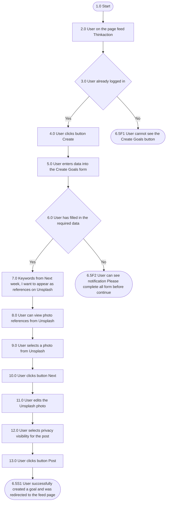
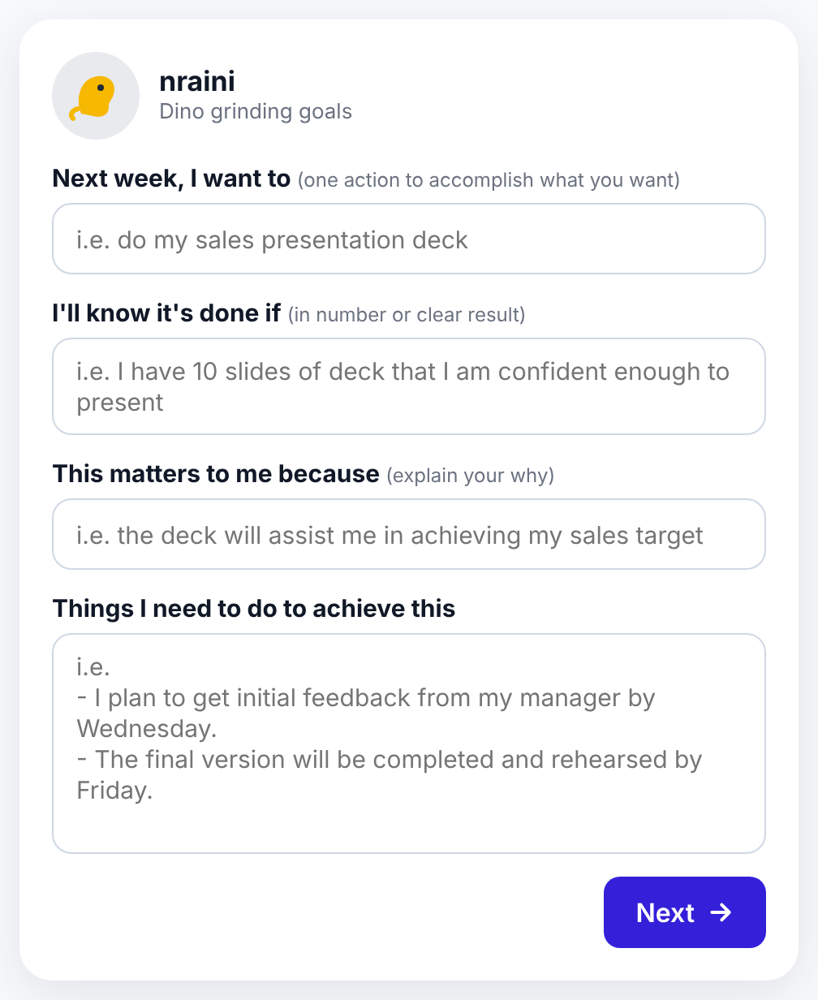
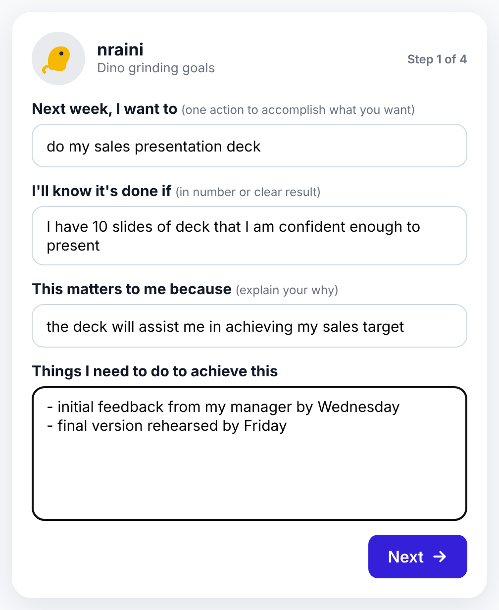
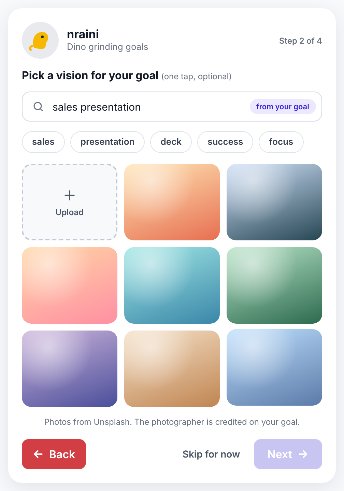
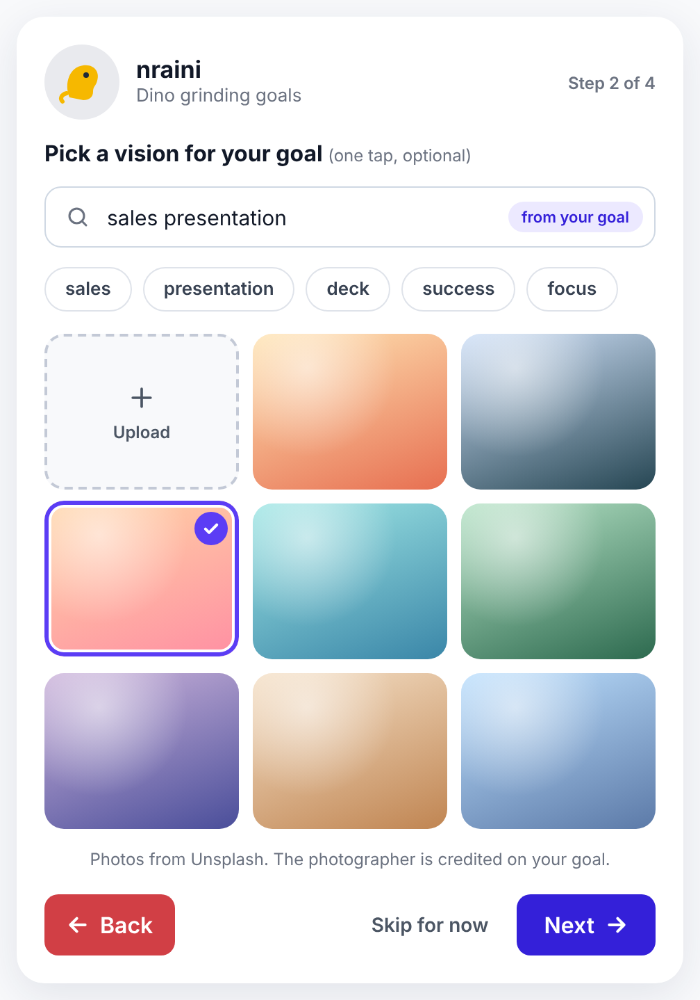
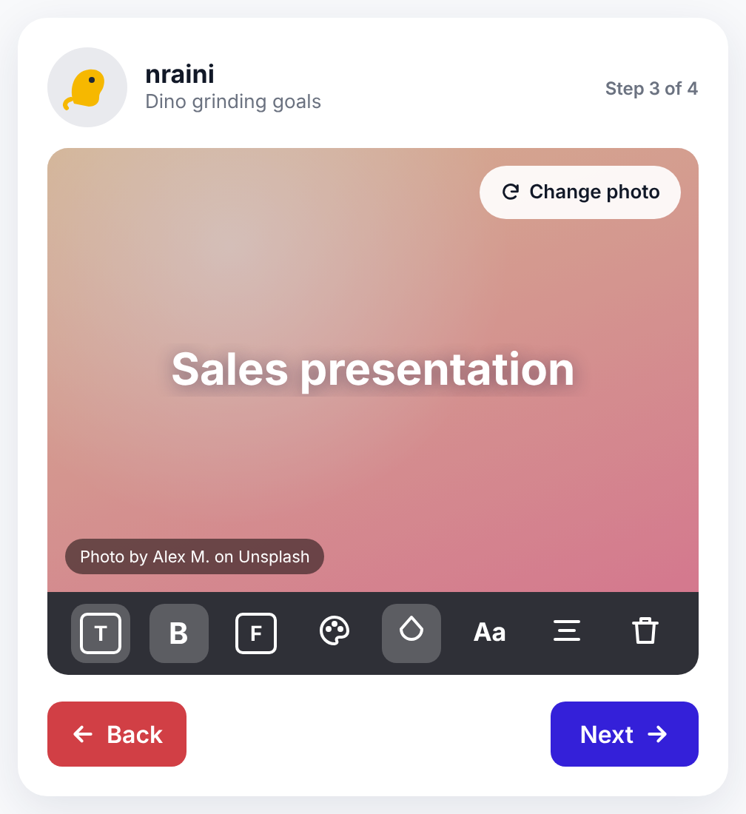
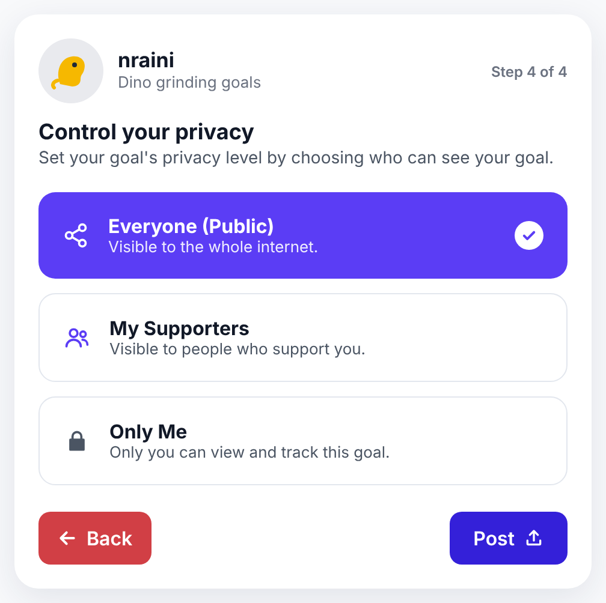
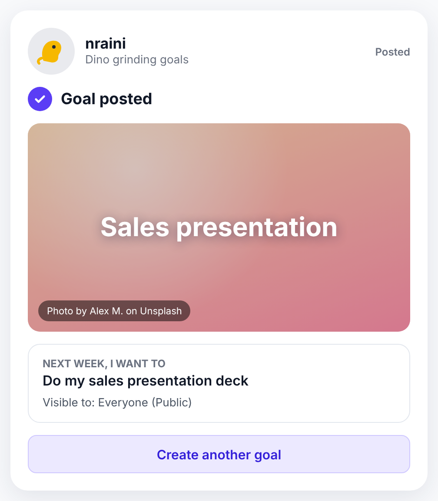

## Mindmap alur

| Process No. | Type | Process / Validation | Yes → Next | No → Next | End? |
| --- | --- | --- | --- | --- | --- |
| 1.0 | Start | Start | 2.0 |  | No |
| 2.0 | Process | User on the page feed Thinkaction | 3.0 |  | No |
| 3.0 | Validation | Validate user already logged in | 4.0 | 6.5F1 User cannot see the "Create Goals" button | Yes |
| 4.0 | Process | User click button create | 5.0 |  | No |
| 5.0 | Process | User enters data into the "Create Goals" form | 6.0 |  | No |
| 6.0 | Validation | Validate whether the user has filled in the required data | 7.0 | 6.5F2 User can see notification "Please complete all form before continue" | Yes |
| 7.0 | Process | Keywords from the "Next week, I want to" column appear immediately as references on Unsplash | 8.0 |  | No |
| 8.0 | Process | User can view photo references from Unsplash | 9.0 |  | No |
| 9.0 | Process | User selects a photo from Unsplash | 10.0 |  | No |
| 10.0 | Process | User click button "next" | 11.0 |  | No |
| 11.0 | Process | User editing an Unsplash photo | 12.0 |  | No |
| 12.0 | Process | User selects "privacy" visibility for the post | 13.0 |  | No |
| 13.0 | Process | User click button post | 6.5S1 User successfully created a goal and was redirected to the feed page |  | Yes |

## Acceptance criteria

### 6.5F1 User cannot see the "Create Goals" button

| Step | Gherkin step | Mockup |
| --- | --- | --- |
| 1.0 | Given the user is not logged in to ThinkAction App |  |
| 2.0 | When the user opens the ThinkAction Feed page |  |
| 3.0 | Then the system displays the Feed page without the "Create Goals" button |  |

### 6.5F2 User can see notification "Please complete all form before continue"

| Step | Gherkin step | Mockup |
| --- | --- | --- |
| 1.0 | Given the user is logged in to ThinkAction App and is on the Feed page |  |
| 2.0 | When the user clicks the Create button |  |
| 3.0 | And the system displays the Create Goals form |  |
| 4.0 | And the user leaves one or more required fields empty in the Create Goals form |  |
| 5.0 | And the user clicks the Next button to continue creating the goal |  |
| 6.0 | Then the system displays the notification "Please complete all form before continue" |  |

### 6.5S1 User successfully created a goal and was redirected to the feed page

| Step | Gherkin step | Mockup |
| --- | --- | --- |
| 1.0 | Given the user is logged in to ThinkAction App and is on the Feed page |  |
| 2.0 | When the user clicks the Create button and completes all required fields in the Create Goals form |  |
| 3.0 | And the system displays Unsplash photo references based on the keywords from the "Next week, I want to" field |  |
| 4.0 | And the user selects an Unsplash photo and clicks Next |  |
| 5.0 | And the system displays the image cropping interface, allowing the user to adjust the image before using it |  |
| 6.0 | And the user selects the privacy visibility of the goal |  |
| 7.0 | And the user clicks the Post button to publish the goal |  |
| 8.0 | Then the system successfully creates the goal and redirects the user to the Feed page |  |

## Referensi

- Foto dari Unsplash memakai API Unsplash (catatan developer di [Overview](/thinkaction/overview)).
- Struktur data goal: [Database](/thinkaction/database).
