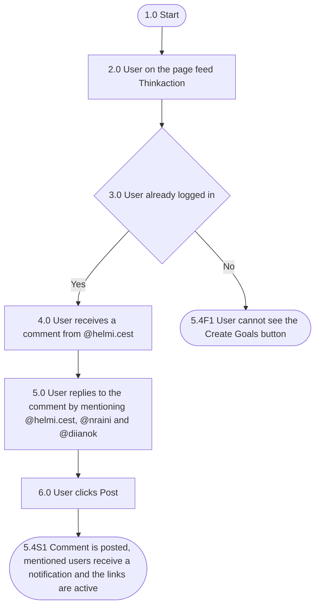
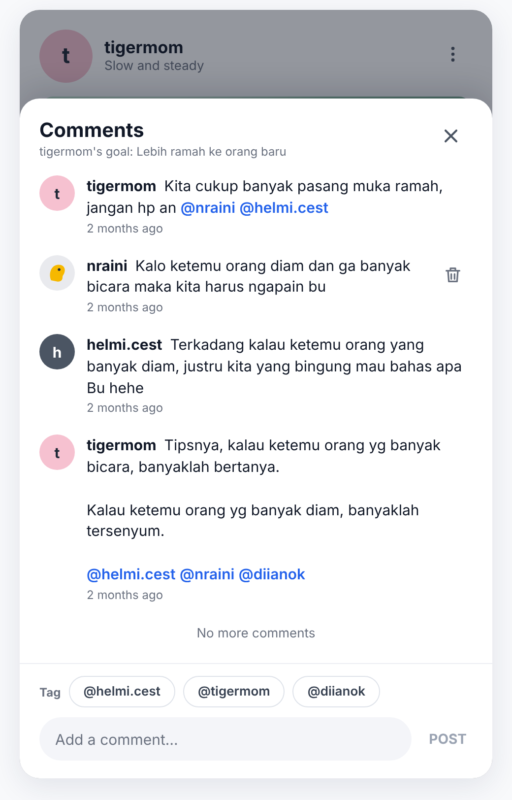
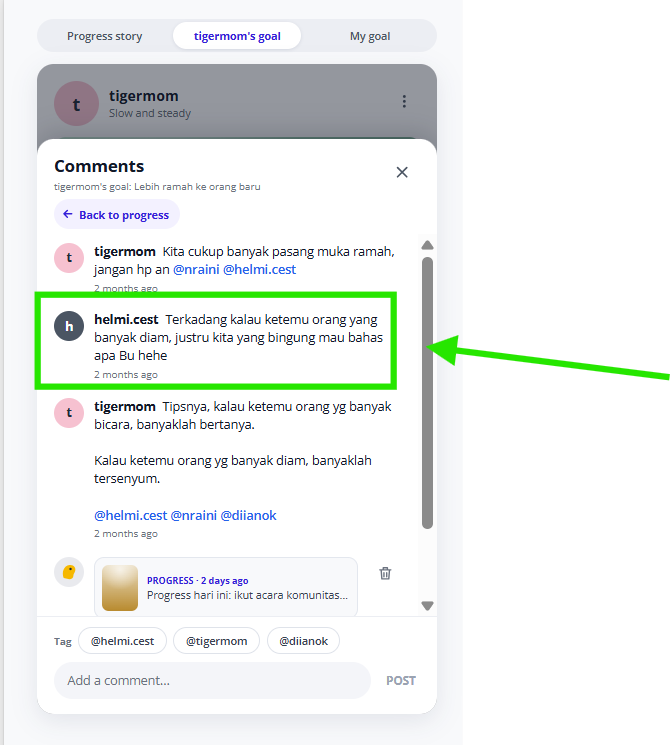
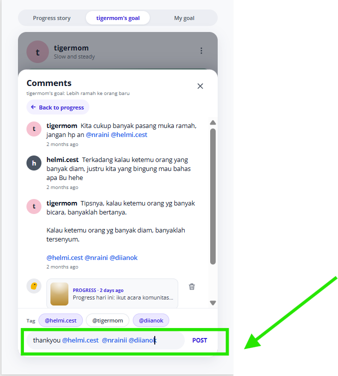
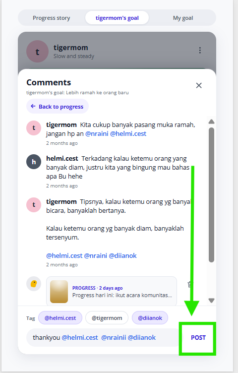
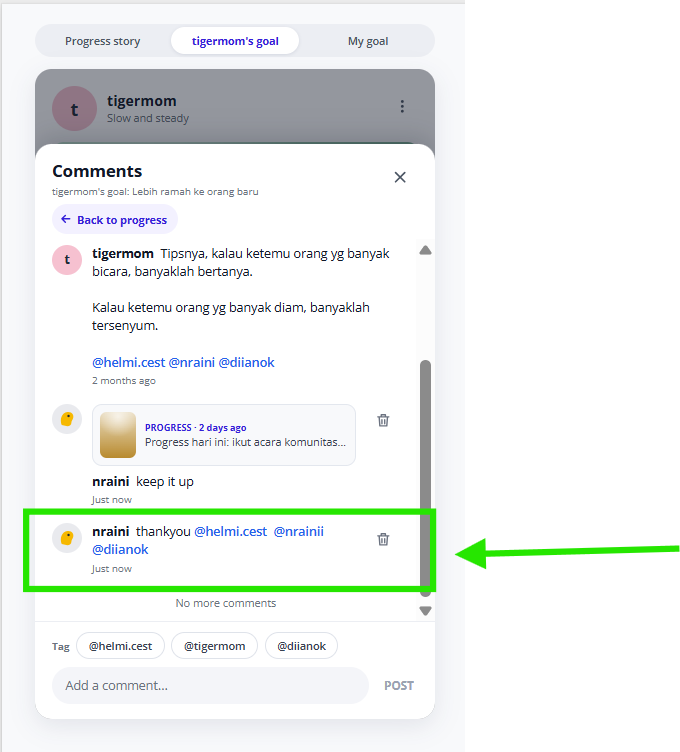

## Mindmap alur

| Process No. | Type | Process / Validation | Yes → Next | No → Next | End? |
| --- | --- | --- | --- | --- | --- |
| 1.0 | Start | Start | 2.0 |  | No |
| 2.0 | Process | User on the page feed Thinkaction | 3.0 |  | No |
| 3.0 | Validation | Validate user already logged in | 4.0 | 5.4F1 User cannot see the "Create Goals" button | Yes |
| 4.0 | Process | User @tigermom receives a comment from @helmi.cest | 5.0 |  | No |
| 5.0 | Process | User replies to the comment by mentioning @helmi.cest, @nraini and @diianok | 6.0 |  | No |
| 6.0 | Process | User clicks "Post" | 5.4S1 The comment is successfully posted, and the mentioned users receive a notification |  | Yes |

## Acceptance criteria

### 5.4F1 User cannot see the "Create Goals" button

| Step | Gherkin step | Mockup |
| --- | --- | --- |
| 1.0 | Given the user is not logged in to ThinkAction App |  |
| 2.0 | When the user opens the ThinkAction Feed page |  |
| 3.0 | Then the system displays the Feed page without the "Create Goals" button |  |

### 5.4S1 The comment is successfully posted, and the mentioned users receive a notification

| Step | Gherkin step | Mockup |
| --- | --- | --- |
| 1.0 | Given the user is logged in to ThinkAction App and is on the Feed page |  |
| 2.0 | When the user opens the comment section of the goal of @tigermom |  |
| 3.0 | And the user @tigermom receives a comment from @helmi.cest |  |
| 4.0 | And the user writes a reply mentioning @helmi.cest @nraini @diianok |  |
| 5.0 | And the user clicks the Post button to publish the comment |  |
| 6.0 | Then the system successfully publishes the comment, all mentioned users receive a notification, and each @user link is active |  |

## Referensi

- Satu komentar bisa menandai lebih dari satu user (ADR002). Link @user harus tetap aktif untuk username yang memakai titik ("."), misalnya @helmi.cest.
- Struktur data komentar: [Database](/thinkaction/database).
