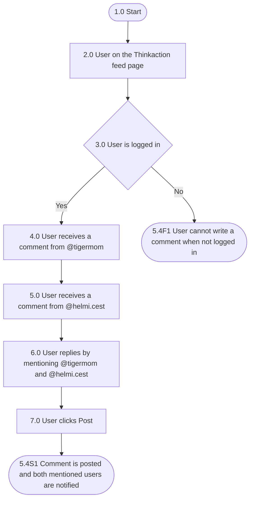

## Mindmap alur

| Process No. | Type | Process / Validation | Yes → Next | No → Next | End? |
| --- | --- | --- | --- | --- | --- |
| 1.0 | Start | Start | 2.0 |  | No |
| 2.0 | Process | User on the Thinkaction feed page | 3.0 |  | No |
| 3.0 | Validation | User is logged in | 4.0 | 5.4F1 User cannot write a comment when not logged in | Yes |
| 4.0 | Process | User receives a comment from @tigermom | 5.0 |  | No |
| 5.0 | Process | User receives a comment from @helmi.cest | 6.0 |  | No |
| 6.0 | Process | User replies to the comment by mentioning @tigermom and @helmi.cest | 7.0 |  | No |
| 7.0 | Process | User clicks "Post" | 5.4S1 The comment is posted and the mentioned users receive a notification |  | Yes |

## Acceptance criteria

### 5.4F1 User cannot write a comment when not logged in

| Step | Gherkin step | Mockup |
| --- | --- | --- |
| 1.0 | Given user is not logged in to the Thinkaction app |  |
| 2.0 | When user opens the Thinkaction feed page |  |
| 3.0 | Then the feed page is displayed without the field for writing comments |  |

### 5.4S1 User mentions two users in one comment and both are notified

| Step | Gherkin step | Mockup |
| --- | --- | --- |
| 1.0 | Given user @nraini is logged in to the Thinkaction app |  |
| 2.0 | And user @nraini is on the feed page |  |
| 3.0 | When user opens the comment section of the goal of @tigermom |  |
| 4.0 | Then the comment list shows the comments from @tigermom and @helmi.cest, and the "Tag" chips for the users in the thread |  |
| 5.0 | When user clicks the "@tigermom" chip |  |
| 6.0 | And user clicks the "@helmi.cest" chip |  |
| 7.0 | And user types "terima kasih ya" in the comment field |  |
| 8.0 | And user clicks "POST" |  |
| 9.0 | Then the system posts the comment with @tigermom and @helmi.cest both highlighted in blue |  |
| 10.0 | And the system sends a notification to @tigermom |  |
| 11.0 | And the system sends a notification to @helmi.cest |  |

## Referensi

- Satu komentar bisa menandai 2 user atau lebih. Setiap user yang ditag menerima satu notifikasi.
- Semua mention berwarna biru, bukan hanya mention terakhir.
