Thinkaction adalah goal tracker. Dokumen ini merangkum update fitur Thinkaction: foto Unsplash saat membuat goal, komentar pada progress, multiple tagging, dan hapus komentar. Kode skenario memakai awalan `F` untuk skenario gagal dan `S` untuk skenario sukses.

## Product vision

### Specific

Update beberapa fitur di Thinkaction:

1. Embed foto Unsplash
2. Komentar pada progress
3. Komentar dengan multiple tagging
4. Hapus komentar

### Measurable

1. Foto vision board bisa diakses dengan mudah.
2. User bisa berkomentar di progress satu sama lain.
3. Bug tagging yang saat ini hanya menandai 1 user diperbaiki, sehingga bisa menandai banyak user.
4. User bisa menghapus komentar yang salah ketik.

### Achievable

Sesuai SOP point.

### Relevant

Meningkatkan user friendliness dan interaksi pengguna.

### Time

30 September.

## Sitemap

```mermaid
flowchart TB
  app["Thinkaction App"] --> auth["Authentication"]
  app --> home["Home"]
  app --> profile["Profile"]
  app --> myGoals["My Goals"]
  app --> comment["Comment"]
  app --> goals["Goals"]
  app --> notifications["Notifications"]
  auth --> a1["1.1 Registration"]
  auth --> a2["1.2 Verification Email"]
  auth --> a3["1.3 Sign In"]
  auth --> a4["1.4 Sign Out"]
  auth --> a5["1.5 Update Account"]
  auth --> a6["1.6 Update Password"]
  auth --> a7["1.7 Reset Password"]
  auth --> a8["1.8 Account Privacy"]
  home --> h1["2.1 Feed Goals"]
  home --> h2["2.2 Progress Goals"]
  profile --> p1["3.1 Supporters"]
  profile --> p2["3.2 Supporting"]
  profile --> p3["3.3 View Goals"]
  myGoals --> m1["4.1 View My Goals"]
  comment --> c1["5.1 Create Comment"]
  comment --> c2["5.2 Read Comment"]
  comment --> c3["5.3 Delete Comment (baru)"]
  comment --> c4["5.4 Multiple Tagging (baru)"]
  comment --> c5["5.5 Comment on Progress (baru)"]
  goals --> g1["6.1 Create Goals"]
  goals --> g2["6.2 Update Progress"]
  goals --> g3["6.3 Delete Goal"]
  goals --> g4["6.4 Complete Goal"]
  goals --> g5["6.5 Embed Photo Unsplash (baru)"]
  notifications --> n1["7.1 Notification"]
```

Fitur bertanda **baru** adalah cakupan dokumentasi ini.

## List scenario

| Module | Feature | Scenario |
| --- | --- | --- |
| Goals | [6.5 Embed Photo Unsplash](/thinkaction/embed-photo-unsplash) | 6.5F1 User cannot see the "Create Goals" button |
|  |  | 6.5F2 User sees notification "Please complete all form before continue" |
|  |  | 6.5S1 User successfully creates a goal with an Unsplash photo and is redirected to the feed page |
| Comment | [5.3 Delete Comment](/thinkaction/delete-comment) | 5.3F1 User cannot delete a comment when not logged in |
|  |  | 5.3S1 User deletes own comment and the comment is removed from the comment list |
|  | [5.4 Multiple Tagging](/thinkaction/multiple-tagging) | 5.4F1 User cannot write a comment when not logged in |
|  |  | 5.4S1 User mentions two users in one comment and both are notified |
|  | [5.5 Comment on Progress](/thinkaction/comment-on-progress) | 5.5F1 User cannot see the field for writing comments |
|  |  | 5.5S1 User comments on a progress and the progress is embedded in the comment list |

## Hasil rapat (MOM)

| Nomor | Topik | Keputusan | Alasan |
| --- | --- | --- | --- |
| ADR001 | Bagaimana cara komentar pada progress story user | Saat user klik komentar, user diarahkan ke halaman komentar postingan dengan progress yang dikomentari ditampilkan sebagai embed (opsi 1). | Meminimalkan budget development, karena yang perlu ditambahkan hanya fitur embed progress yang dikomentari. |
| ADR002 | Apakah komentar perlu mendukung mention untuk beberapa orang sekaligus | User bisa mention 2 orang atau lebih sekaligus (opsi 1). | Meningkatkan user friendliness produk. |
| ADR003 | Apakah user perlu dapat menghapus komentar yang sudah dibuat | Dibuatkan fitur hapus komentar untuk user (opsi 1). | Meningkatkan user friendliness produk. |
| ADR004 | Bagaimana user menampilkan foto goal jika belum memiliki foto sendiri | Embed foto dari Unsplash yang mudah diakses user (opsi 1). | Meningkatkan user friendliness produk. |

Tanggal rapat: 12 Oktober 2026. Peserta: Aini, Bu Kartika.

## Halaman terkait

<Columns cols={2}>
  <Card title="6.5 Embed Photo Unsplash" icon="image" href="/thinkaction/embed-photo-unsplash">
    Pilih foto vision goal dari Unsplash saat membuat goal.
  </Card>

  <Card title="5.3 Delete Comment" icon="trash-2" href="/thinkaction/delete-comment">
    Hapus komentar sendiri dengan Undo 5 detik.
  </Card>

  <Card title="5.4 Multiple Tagging" icon="at-sign" href="/thinkaction/multiple-tagging">
    Tag banyak user dalam satu komentar.
  </Card>

  <Card title="5.5 Comment on Progress" icon="message-circle" href="/thinkaction/comment-on-progress">
    Komentar dari progress dengan embed progress.
  </Card>
</Columns>
